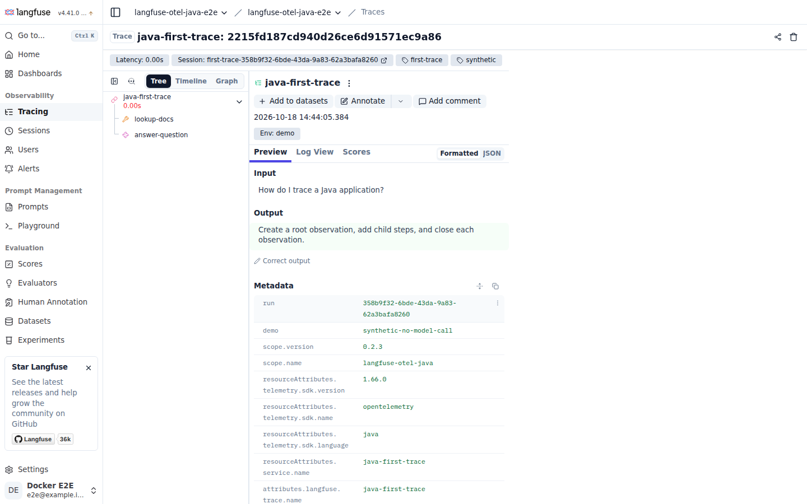

# langfuse-otel-java

OpenTelemetry-based Langfuse tracing for Java, Spring AI, and LangChain4j.

[](https://github.com/ChoMinGi/langfuse-otel-java/actions/workflows/ci.yml)
[](https://openjdk.org/)
[](https://central.sonatype.com/artifact/io.github.chomingi/langfuse-otel-core)
[](LICENSE)

Record a Java AI workflow as a trace in Langfuse, with tool and model calls as child observations.
The core handles Langfuse attributes, parent context, and observation completion. The Spring Boot
starter adds tracing to supported model beans.

Use the **core** when you call a provider directly or manage your own async work. Use the
**starter** for Spring AI or LangChain4j applications. Both can share an existing OpenTelemetry SDK.
Input and output capture is off by default in the observation API and automatic instrumentation.

**Current release: 0.2.3.** The 0.2.x line is production preview, with Spring Boot 3 and Spring AI 1
support. Check [compatibility](#compatibility) before adding the starter.

[Quick start](#quick-start) · [Spring Boot guide](docs/spring-boot.md) · [Observation API](OBSERVATION-API.md) · [Migration](MIGRATION-0.2.md)

## Quick start

### Your first trace (Java 11+, no model API key)

You need Java 11+ and a Langfuse project. Get its public and secret keys from **Settings → API Keys**.
This example downloads the published library from Maven Central and sends a fixed question and
answer. It makes no model calls.



*The example running against Langfuse 4.41.0.
[Screenshot and recorded observations](docs/images/README.md).*

```bash
git clone https://github.com/ChoMinGi/langfuse-otel-java.git
cd langfuse-otel-java

export LANGFUSE_HOST="https://cloud.langfuse.com" # EU; use your project's region
export LANGFUSE_PUBLIC_KEY="pk-lf-..."
export LANGFUSE_SECRET_KEY="sk-lf-..."

./mvnw -B -ntp -f examples/first-trace/pom.xml compile exec:java
```

For US projects, use `https://us.cloud.langfuse.com`; for Japan, `https://jp.cloud.langfuse.com`.
Self-hosted projects need HTTPS and Observations API v2. See the
[example guide](examples/first-trace/) for Windows commands and troubleshooting.

The command checks that Langfuse received all three observations, then prints a link:

```text
Verified 3 observations: CHAIN -> TOOL + GENERATION
Verified parent links, synthetic input/output, and shared metadata.
Open: https://<your-host>/project/<your-project>/traces/<trace-id>
```

[FirstTrace.java](examples/first-trace/src/main/java/com/example/FirstTrace.java) contains the
tracing code. It enables content capture for its fixed demo strings; choose a capture policy
before replacing them with application data.

Tried it? [Tell us what worked or where you got stuck](https://github.com/ChoMinGi/langfuse-otel-java/issues/new?template=first_trace_feedback.yml).
English and Korean are welcome.

## Add it to your application

### Spring Boot (Dedicated Exporter Quick Start)

Add the starter alongside your existing Spring AI or LangChain4j provider dependency:

```xml
<dependency>
    <groupId>io.github.chomingi</groupId>
    <artifactId>langfuse-otel-spring-boot-starter</artifactId>
    <version>0.2.3</version>
</dependency>
```

```yaml
# application.yml
langfuse:
  otel-mode: standalone
  public-key: ${LANGFUSE_PUBLIC_KEY}
  secret-key: ${LANGFUSE_SECRET_KEY}
  host: https://cloud.langfuse.com
```

Calls through supported Spring-managed model proxies now produce observations with model details
and usage when available. To include prompts and responses, enable
[content capture](docs/spring-boot.md#input-output-and-exceptions).

This configuration creates a dedicated SDK and exporter. If your application already owns an
OpenTelemetry SDK, use [external mode](docs/spring-boot.md#choose-the-opentelemetry-sdk).
The starter leaves provider and web server dependencies to your application. Boot 3 web apps
also need to review the [Spring 6.2 limitations](SECURITY.md#spring-62-web-framework-limitations).

### Standalone (No Spring)

```xml
<dependency>
    <groupId>io.github.chomingi</groupId>
    <artifactId>langfuse-otel-core</artifactId>
    <version>0.2.3</version>
</dependency>
```

Create a `LangfuseOtel` instance for the application's lifetime, as shown in the
[first-trace example](examples/first-trace/). Wrap a call with an observation:

```java
try (var observation = langfuse.observation("chat", ObservationType.GENERATION).start();
     var scope = observation.makeCurrent()) {
    try {
        observation.input(prompt);
        var response = model.call(prompt);
        observation.output(response);
    } catch (RuntimeException | Error failure) {
        observation.fail(failure);
        throw failure;
    }
}
```

Here, `model` and `prompt` are application code. `input()` and `output()` use the capture policy
and collect nothing by default. Closing the scope restores the thread's context; closing the
observation ends its span. Call `fail()` to record an error.

For async calls, explicit parents, and cancellation, see the [observation API](OBSERVATION-API.md).
Use one instrumentation path per model call to avoid recording both a manual and an automatic
generation.

<a id="existing-opentelemetry-sdk-production-recommended"></a>

### Existing OpenTelemetry SDK

Use `LangfuseOtel.externalBuilder(openTelemetry)` in plain Java. In Spring, set
`langfuse.otel-mode=external` and supply an `OpenTelemetry` bean.
Your SDK or Collector must export to Langfuse; the library leaves its flush and shutdown to you.
The [SDK setup guide](docs/spring-boot.md#choose-the-opentelemetry-sdk) covers bean selection,
the OTLP endpoint, and authentication headers.

## What gets traced

The starter supports these model calls through Spring-managed proxies:

| Framework | Model calls |
| --- | --- |
| Spring AI | Chat, streaming chat, embeddings, and images |
| LangChain4j | Chat, streaming chat, embeddings, and image generation/editing |

It records model names, available token usage, model parameters, and streaming first-token timing.
Errors include the exception type by default. Input, output, exception messages, and stack traces
require opt-in. See the [method list and proxy limits](docs/spring-boot.md#what-gets-traced).

## Features

- Add `@ObserveGeneration` to a Spring service method to record a generation.
- Attach user/session IDs, tags, and request metadata to child observations.
- Apply content and exception redactors before export.
- Read local exporter status, or use the optional Actuator health component and meters.
- Link prompts from the optional `langfuse-java` client to legacy generation spans.

The [Spring Boot guide](docs/spring-boot.md) covers annotations, context, redaction, and health.
The [observation guide](OBSERVATION-API.md#prompt-versioning-with-the-legacy-api) includes prompt linking.

## Compatibility

| Dependency | Tested version / requirement |
| --- | --- |
| Java | Core: 11, 17, 21; starter: 17, 21 |
| OpenTelemetry SDK | 1.66.0 |
| Spring Boot | 3.5.16 |
| Spring AI | 1.0.9 / 1.1.8 |
| LangChain4j | 1.0.0 / 1.18.0 |
| langfuse-java | 0.2.0, optional prompt client |
| Langfuse Cloud | OTLP v4 ingestion and Observations API v2 |
| Langfuse self-hosted | OTLP requires v3.22.0+; API v2 read-back requires v4 and is tested with 4.41.0 |

Framework consumer tests exercise chat calls in non-web Boot applications. Adapter tests also cover
streaming, embeddings, and images. See [test coverage](docs/spring-boot.md#test-coverage) for the
scope and [release verification](RELEASE-0.2.3.md) for the published artifacts.

## Production-preview limitations

- Automatic tracing requires a call through a supported Spring proxy. Direct provider calls and
  non-proxyable model types need explicit instrumentation.
- Provider-owned executors may need explicit context propagation. Configure application timeouts:
  observations remain open until completion, failure, or cancellation.
- Instrumented Reactor subscriptions use a process-global scheduler hook while active.
- Spring AOT and GraalVM native-image builds are not tested or supported.

See the [adapter limits](docs/spring-boot.md#limitations) and [data collection policy](SECURITY.md).
Boot 4 and Spring AI 2 are planned for a later starter line; see the [roadmap](ROADMAP.md) and
[maintenance policy](SECURITY.md#supported-versions).

## More documentation

- [Examples](examples/): first trace, Spring AI, and LangChain4j applications.
- [Migration from 0.1.x](MIGRATION-0.2.md).
- [Design](DESIGN.md): lifecycle, context propagation, and SDK ownership.
- [Changelog](CHANGELOG.md) and [release notes](https://github.com/ChoMinGi/langfuse-otel-java/releases).

## Contributing

Bug reports and installation feedback are welcome. For development setup and checks, see
[CONTRIBUTING.md](CONTRIBUTING.md).

## License

[MIT](LICENSE).
